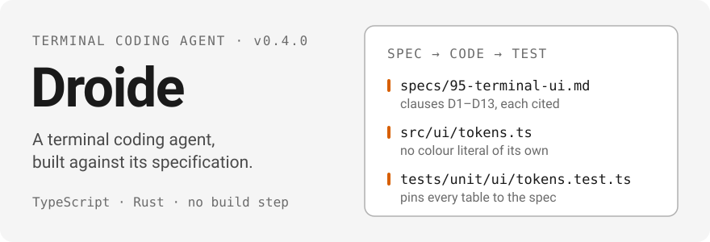
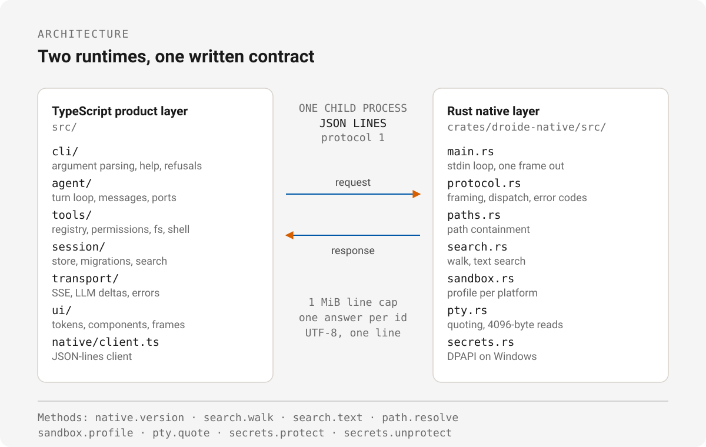

<p align="center"><a href="./README.md">English</a> · <a href="./README.ru.md">Русский</a> · <a href="./README.zh-CN.md">中文</a></p>

<div align="center">
  
</div>

**Droide** is a clean-room reimplementation of the `droid` CLI v1.9.0: the same
command surface, help pages, refusals and exit codes, rebuilt from a written
specification instead of copied source.

The product layer is TypeScript — Node 24, ESM, types stripped at load, no build
step. The native layer is Rust, behind one JSON-lines child process. Both are
written against a single contract: [`specs/`](./specs/README.md).

## Why this exists

The specification is the deliverable. The reimplementation is the check that the
specification is complete and unambiguous enough to build from.

- **SDD — spec first.** Every subsystem has one document under `specs/`, and
  nothing is implemented before it is specified. Clauses are labelled
  `[observed]`, `[derived]` or `[inferred]`, and each carries a citation — a
  recovered file and line, or a recorded golden.
- **ADD — decisions as records.** Anything that constrains structure is an ADR
  in [`docs/adr/`](./docs/adr/0000-template.md), written when the decision is
  made. The split into two runtimes is
  [ADR 0002](./docs/adr/0002-hybrid-rust-typescript-layers.md); the rule that no
  subject code is copied is
  [ADR 0003](./docs/adr/0003-evidence-first-clean-room-policy.md).
- **TDD — clauses compile to tests.** Every behavioural clause names at least one
  deterministic test: no network, no credentials, no wall clock. Where the build
  is narrower than its clause, the code says so with a `TODO(spec …)` marker and
  [`docs/gaps.md`](./docs/gaps.md) lists it.

## Status

What runs today, run against this tree:

| Surface                                                                                    | Today                                                                                                                                                                                                                                                 |
| ------------------------------------------------------------------------------------------ | ----------------------------------------------------------------------------------------------------------------------------------------------------------------------------------------------------------------------------------------------------- |
| `--version`, `--help`, subcommand help                                                     | works — reports `1.9.0`; 20/20 recorded parity cases against the subject (goldens are local, see [ADR 0004](./docs/adr/0004-parity-harness-with-optional-oracle.md))                                                                                  |
| `doctor`                                                                                   | works — 16 named checks; eleven are real probes (config, environment, system, binaries, updates, filesystem, git, proxy, certs, auth, mcp) and the rest report `skip` with a reason                                                                               |
| `search` / `find`                                                                          | works — served from a local transcript index with a proving fallback to the literal scan; `--reindex` refreshes it                                                                                                                                    |
| `mcp list`, `mcp add`, `mcp remove`, `mcp permissions`                                     | work — merged configuration, surgical JSONC edits that keep comments, atomic writes, permission list/revoke/clear                                                                                                                                     |
| `plugin list`, `plugin marketplace`, `plugin install`, `plugin uninstall`, `plugin update` | work — git-backed marketplaces validated before adoption, atomic registry merges, collision and reference refusals                                                                                                                                    |
| `exec`                                                                                     | works for `text`, `json` and `stream-json` with a prompt, `-f` or stdin, session continuation and streaming input; `stream-jsonrpc`, ACP, `--mission` and `--list-tools` refuse                                                                       |
| `resume`                                                                                   | works — lists sessions, accepts a UUID or link, continues through the `exec -s` path, forks with `--fork`                                                                                                                                             |
| `daemon`                                                                                   | works locally — WebSocket transport, JSON-RPC, auth gate, single instance, ordered shutdown; Remote Control and the port proxy are declared, not built                                                                                                |
| `droide` with no arguments                                                                 | launches the interactive shell on a TTY pair; a typed prompt runs an agent turn with streamed rows, approvals and Esc-cancel                                                                                                                          |
| native helper                                                                              | 15 JSON-line methods (including PTY sessions), typed and validated on the TypeScript side, 69 Rust tests, plus a contract test that spawns a real process through the compiled binary (`npm run test:native`) — **not yet wired into tool execution** |
| test suite                                                                                 | 1096 tests in 116 files: 1090 pass, 6 skipped, plus 69 Rust tests                                                                                                                                                                                     |

`exec` needs a model credential. Without one it refuses instead of guessing:

```console
$ node bin/droide.mjs exec -o json "hi"
Authentication failed. Please log in using /login or set a valid FACTORY_API_KEY environment variable.
```

Declared, in flight:

| Surface                                                                    | State                                                                                                                                          |
| -------------------------------------------------------------------------- | ---------------------------------------------------------------------------------------------------------------------------------------------- |
| `mcp auth`                                                                 | PKCE, the loopback callback, the token exchange and the sealed credential store are implemented and tested; the command that wires them is not |
| `computer register\|remove\|ssh\|port-forward`, `update` without `--check` | options parse, help prints, every action refuses with exit 1 or 2                                                                              |
| macOS/Linux credential stores                                              | only Windows DPAPI exists; the store refuses rather than writing plaintext                                                                     |
| Remote Control, relay and port proxy; the interactive session picker       | declared in `specs/70` and `specs/10`; `docs/gaps.md` names every clause                                                                       |
| the native layer inside the tool runtime                                   | the helper is tested end to end but the tools still reach it through the fake                                                                  |

The failure is deliberate, and it is observable — exit 64 for a command that is
specified but not built, exit 1 for an option that is not:

```console
$ node bin/droide.mjs update
droide: the "update" command is specified but not implemented in this build.

$ node bin/droide.mjs exec --list-tools
--list-tools is not implemented in this build.
```

Current shape of the tree: 11 numbered specification documents — shared context
plus ten subsystem specs, 9,333 lines under `specs/` — 123 TypeScript files
under `src/` (33,069 lines), 8 Rust files under `crates/droide-native/src/`,
8 ADRs, 1096 TypeScript tests and 69 Rust tests. Every place where the build is
narrower than the clause it cites is marked `TODO(spec …)` in the code and
counted in [`docs/gaps.md`](./docs/gaps.md), which `npm run gaps` regenerates.

## Quick start

Node 24 or newer, and a Rust toolchain for the native layer.

```sh
npm ci                          # install once; there is no build step
node bin/droide.mjs --version   # 1.9.0
node bin/droide.mjs --help
node bin/droide.mjs doctor      # 16 named checks (11 real probes), text or --json
node bin/droide.mjs mcp list
node bin/droide.mjs search x --json
npm test                        # 906 tests
npm run typecheck
npm run test:parity             # 20/20
cargo test --workspace          # 57 tests
```

`exec` is the machine-facing surface (`text`, `json`, `stream-json`):

```sh
node bin/droide.mjs exec "review app.tsx"
node bin/droide.mjs exec -o json "review app.tsx"
node bin/droide.mjs exec -f prompt.txt --auto low
```

## Architecture

<div align="center">
  
</div>

- **`src/` — product layer, TypeScript.** `cli/` parses arguments and owns help
  and refusals; `agent/` the turn loop and message model; `tools/` the registry,
  validators, permission matrix and fs/shell/todo tools; `session/` the store,
  migrations, transcript and search; `transport/` SSE, LLM deltas and error
  identity; `ui/` the token tables, components and frame renderer; `app/` the
  wiring between them.
- **The boundary is one child process and one line per message.** Requests are
  `{"id","method","params"}`, answers are `{"id","result"}` or
  `{"id","error":{"code","message"}}`, UTF-8, protocol version 1, request lines
  capped at 1 MiB. The client (`src/native/client.ts`) matches answers by id and
  treats every answer as untrusted input.
- **`crates/droide-native/` — native layer, Rust.** `main.rs` is a stdio loop
  that flushes one frame per request; `protocol.rs` frames and dispatches;
  `paths.rs` enforces containment; `search.rs` walks and searches; `sandbox.rs`
  describes bubblewrap, seatbelt or "no confinement" profiles; `pty.rs` quotes
  the command line the way the subject re-splits it; `secrets.rs` stores secrets
  with DPAPI on Windows.
- The fifteen methods are `native.version`, `hash.sha256`, `search.walk`,
  `search.text`, `path.resolve`, `sandbox.profile`, `pty.quote`, `pty.spawn`,
  `pty.read`, `pty.write`, `pty.resize`, `pty.kill`, `pty.close`,
  `secrets.protect`, `secrets.unprotect`. The TypeScript client validates every
  response shape, the helper has its own tests, and `npm run test:native` runs the
  contract against the compiled binary. The tool layer still reaches the helper
  through nothing but the fake, so wiring is the next step.

## Specifications and decisions

| Document                                                                     | Subject                                                  |
| ---------------------------------------------------------------------------- | -------------------------------------------------------- |
| [`00-context.md`](./specs/00-context.md)                                     | shared context: the subject, its evidence and vocabulary |
| [`10-cli-surface.md`](./specs/10-cli-surface.md)                             | commands, options, help, refusals, exit codes            |
| [`20-agent-loop.md`](./specs/20-agent-loop.md)                               | message model, turn loop, provider adapter               |
| [`30-tools-and-sandbox.md`](./specs/30-tools-and-sandbox.md)                 | tool registry, validators, permissions, sandbox          |
| [`40-sessions-and-storage.md`](./specs/40-sessions-and-storage.md)           | session files, migrations, transcript, search            |
| [`50-transport-and-auth.md`](./specs/50-transport-and-auth.md)               | URLs, headers, SSE, error identity, auth                 |
| [`60-extensions-mcp-and-skills.md`](./specs/60-extensions-mcp-and-skills.md) | MCP servers, tool naming, skills, plugins                |
| [`70-daemon-and-remote-control.md`](./specs/70-daemon-and-remote-control.md) | daemon RPC surface and remote control                    |
| [`80-exec-and-streaming.md`](./specs/80-exec-and-streaming.md)               | non-interactive runs and stream formats                  |
| [`90-native-layer.md`](./specs/90-native-layer.md)                           | the helper process and its methods                       |
| [`95-terminal-ui.md`](./specs/95-terminal-ui.md)                             | tokens, capabilities, shell layout, frames               |

Status vocabulary — `draft`, `review`, `stable`, `blocked` — is defined in
[`specs/README.md`](./specs/README.md); per-spec state lives in
[`docs/status.md`](./docs/status.md), and the milestones and their gates in
[`docs/plan.md`](./docs/plan.md). How each part of the subject was recovered is
mapped in [`docs/architecture/README.md`](./docs/architecture/README.md) and the
[`evidence/`](./evidence/README.md) ledger.

Decisions that shaped the build:

| ADR                                                              | Decision                                                              |
| ---------------------------------------------------------------- | --------------------------------------------------------------------- |
| [0001](./docs/adr/0001-bun-standalone-extraction.md)             | recover the embedded JavaScript bundle before decompiling native code |
| [0002](./docs/adr/0002-hybrid-rust-typescript-layers.md)         | Rust for the native layer, TypeScript for the product layer           |
| [0003](./docs/adr/0003-evidence-first-clean-room-policy.md)      | evidence-first clean-room policy                                      |
| [0004](./docs/adr/0004-parity-harness-with-optional-oracle.md)   | declarative parity cases with an optional oracle                      |
| [0005](./docs/adr/0005-project-name-and-parity-normalisation.md) | the project is `droide`; the CLI design stays identical               |
| [0006](./docs/adr/0006-terminal-ui-stack.md)                     | the terminal UI is React + Ink, with tokens from the spec             |
| [0007](./docs/adr/0007-update-channel.md)                        | updates come from this repository's releases, never the subject's     |
| [0008](./docs/adr/0008-oauth-credential-envelope.md)             | MCP OAuth credentials are sealed by the OS, never by a key file       |
| [0009](./docs/adr/0009-update-installation.md)                   | updates are staged, digest-verified, swapped atomically and rolled back |

## Contributing

Read [`CONTRIBUTING.md`](./CONTRIBUTING.md) first. A change is mergeable when
these gates pass:

1. `npm run typecheck`
2. `npm run format:check`
3. `npm test`
4. `npm run test:parity` (needs the local goldens under `.work/parity`)
5. `cargo test --workspace`
6. `npm run gaps:check`
7. the spec clause it implements is cited in the commit message or PR body

Two rules keep the method intact: nothing is implemented before it is specified,
and no behaviour is smoothed over with a guess. Where the build is narrower than
its clause, mark it `TODO(spec …)`; `npm run gaps` regenerates
[`docs/gaps.md`](./docs/gaps.md) and `npm run gaps:check` fails when it is stale.

Tests live in [`tests/`](./tests/README.md): `unit/` is fast and hermetic,
`integration/` crosses a process boundary, `parity/` replays recorded CLI cases.

## Licence

MIT — see [`LICENSE`](./LICENSE). No code from the subject is copied, and no
proprietary artefact is tracked here
([ADR 0003](./docs/adr/0003-evidence-first-clean-room-policy.md)).
