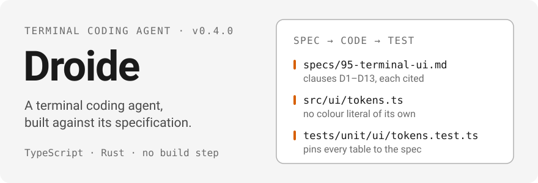

<a href="./README.md">English</a> · <a href="./README.ru.md">Русский</a> · <a href="./README.zh-CN.md">中文</a>

  

**Droide** — терминальный кодинг-агент для вашего репозитория: одна
поверхность команд для промптов, сессий, инструментов, серверов MCP, плагинов и
локального демона, управляемая из терминала.

Продуктовый слой — TypeScript: Node 24, ESM, типы срезаются при загрузке, шага
сборки нет. Нативный слой — Rust, за одним дочерним процессом на JSON-lines.
Оба написаны против одного контракта: [`specs/`](./specs/README.md).

## Как это устроено

Поставляемый результат — спецификация. Реализация — это проверка того, что
спецификация достаточно полна и однозначна, чтобы по ней можно было строить.

- **SDD — сначала spec.** У каждой подсистемы один документ в `specs/`, и
  ничего не реализуется до того, как оно специфицировано. Пункты помечены
  `[observed]`, `[derived]` или `[inferred]`, и каждый несёт ссылку — на
  источник или на записанный кейс.
- **ADD — решения как записи.** Всё, что ограничивает структуру, — это ADR
  в [`docs/adr/`](./docs/adr/0000-template.md), написанный в момент принятия
  решения. Разделение на два рантайма —
  [ADR 0002](./docs/adr/0002-hybrid-rust-typescript-layers.md); правило, что
  восстановленный материал не попадает в сборку, —
  [ADR 0003](./docs/adr/0003-evidence-first-clean-room-policy.md).
- **TDD — пункты компилируются в тесты.** Каждый поведенческий пункт называет
  хотя бы один детерминированный тест: без сети, без учётных данных, без
  системных часов. Там, где реализация покрывает меньше своего пункта, код
  говорит об этом маркером `TODO(spec …)`, а
  [`docs/gaps.md`](./docs/gaps.md) это перечисляет.

## Статус

Что работает сегодня — проверено на этом дереве:

| Поверхность                                                                                | Сейчас                                                                                                                                                                                                                                                                                                                                                        |
| ------------------------------------------------------------------------------------------ | ------------------------------------------------------------------------------------------------------------------------------------------------------------------------------------------------------------------------------------------------------------------------------------------------------------------------------------------------------------- |
| `--version`, `--help`, help подкоманд                                                      | работает — сообщает `0.8.0`; 20 записанных CLI-кейсов проходят (снапшоты в репозитории, см. [ADR 0010](./docs/adr/0010-own-brand-and-snapshot-harness.md))                                                                                                                                                                                                    |
| `doctor`                                                                                   | работает — 16 именованных проверок, двенадцать из них по умолчанию: config, environment, system, binaries, updates, filesystem, git, proxy, certs, connectivity, auth, daemon; `--checks all` добавляет custom-models, inference, mcp и exec, которые запускают серверы или тратят деньги. Проверка, которая не может выполниться, сообщает `skip` с причиной |
| `search` / `find`                                                                          | работает — обслуживается локальным индексом транскриптов с доказывающим откатом на буквальный скан; `--reindex` обновляет его                                                                                                                                                                                                                                 |
| `mcp list`, `mcp add`, `mcp remove`, `mcp permissions`                                     | работают — объединённая конфигурация, точечные правки JSONC с сохранением комментариев, атомарные записи, список, отзыв и очистка разрешений                                                                                                                                                                                                                  |
| `plugin list`, `plugin marketplace`, `plugin install`, `plugin uninstall`, `plugin update` | работают — маркетплейсы на git, валидируемые до принятия, атомарные слияния реестра, отказы при коллизиях и битых ссылках                                                                                                                                                                                                                                     |
| `exec`                                                                                     | работает для вывода `text`, `json` и `stream-json` с промптом, `-f` или stdin, продолжением сессии и потоковым вводом; `--list-tools` печатает инструменты выбранной модели без учётных данных; `stream-jsonrpc`, ACP и `--mission` отказывают                                                                                                                |
| `resume`                                                                                   | работает — перечисляет сессии, принимает UUID или ссылку, продолжает через путь `exec -s`, форкает с `--fork`                                                                                                                                                                                                                                                 |
| `update`, `update --check`, `update -v <version>`                                          | работают — проверка читает ленту релизов этого репозитория; установка потоково пишет архив в staging, хешируя его, меняет атомарно и откатывается, если единственная проба не прошла                                                                                                                                                                          |
| `daemon`                                                                                   | работает локально — транспорт WebSocket, JSON-RPC, шлюз аутентификации, единственный экземпляр, упорядоченное завершение; Remote Control и прокси порта заявлены, но не построены                                                                                                                                                                             |
| `droide` без аргументов                                                                    | запускает интерактивную оболочку на паре TTY; введённый промпт выполняет ход агента с потоковыми строками, подтверждениями и отменой по Esc                                                                                                                                                                                                                   |
| `droide` (анимация)                                                                        | запускает интерактивный shell на TTY-паре после ~1.4 с анимации логотипа (`general.logoAnimation`: по умолчанию `once`, `always`, `off`; `DROIDE_NO_ANIMATION=1` отключает)                                                                                                                                                                                   |
