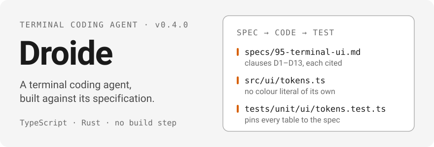
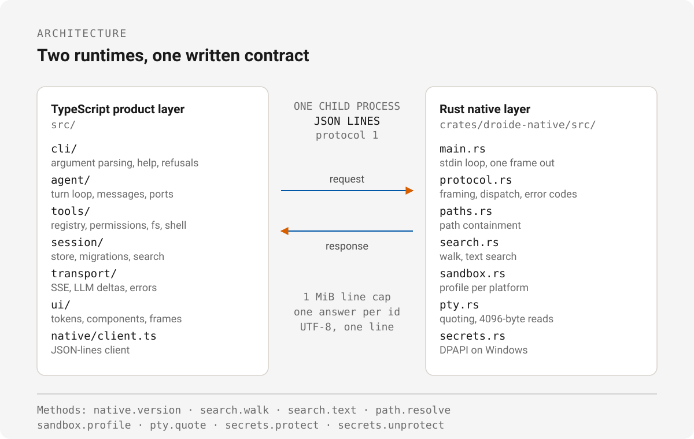

<p align="center"><a href="./README.md">English</a> · <a href="./README.ru.md">Русский</a> · <a href="./README.zh-CN.md">中文</a></p>

<div align="center">
  
</div>

**Droide** 是 `droid` CLI v1.9.0 的净室重新实现：相同的
命令行接口、帮助页面、拒绝行为与退出码，依据一份成文规格重建，
而非复制源码。

产品层是 TypeScript——Node 24、ESM、加载时剥离类型、没有构建步骤。
原生层是 Rust，位于一个 JSON-lines 子进程之后。两者都针对同一份契约编写：
[`specs/`](./specs/README.md)。

## 为什么要有这个项目

规格本身就是交付物。重新实现是对规格的检验：它是否完整、是否
无歧义到足以据此构建。

- **SDD——规格先行。** 每个子系统在 `specs/` 下都有一份文档，
  未写进规格的东西不会被实现。条款被标注为 `[observed]`、`[derived]`
  或 `[inferred]`，并且每条都带有引用——一个已还原的文件与行号，
  或一份录制下来的 golden。
- **ADD——决策即记录。** 任何约束结构的决定都是 ADR，写于
  [`docs/adr/`](./docs/adr/0000-template.md)，在做出决定的那一刻落笔。
  拆成两个运行时是
  [ADR 0002](./docs/adr/0002-hybrid-rust-typescript-layers.md)；不复制原始程序
  任何代码这条规则是
  [ADR 0003](./docs/adr/0003-evidence-first-clean-room-policy.md)。
- **TDD——条款编译成测试。** 每条行为条款都至少对应一个确定性测试：
  不依赖网络、不依赖凭据、不依赖系统时间。当实现的覆盖窄于其条款时，
  代码用 `TODO(spec …)` 标记说明这一点，并由
  [`docs/gaps.md`](./docs/gaps.md) 列出。

## 现状

以下是当前在这棵代码树上实际运行的结果：

| 功能面 | 当前 |
| --- | --- |
| `--version`、`--help`、子命令帮助 | 可用——报告 `1.9.0`；对原始程序的 20/20 条录制一致性用例通过（golden 在本地，见 [ADR 0004](./docs/adr/0004-parity-harness-with-optional-oracle.md)） |
| `doctor` | 可用——16 项具名检查；其中十项是真实探测（config, environment, system, binaries, filesystem, git, proxy, certs, auth, mcp），其余报告 `skip` 并给出原因 |
| `search` / `find` | 可用——由本地转录索引提供，并可回退到字面扫描作为佐证；`--reindex` 会刷新它 |
| `mcp list`、`mcp add`、`mcp remove`、`mcp permissions` | 可用——合并配置，保留注释的定点 JSONC 编辑，原子写入，权限的列出、撤销与清空 |
| `plugin list`、`plugin marketplace`、`plugin install`、`plugin uninstall`、`plugin update` | 可用——基于 git 的 marketplace 在采纳前先校验，原子注册表合并，冲突与悬空引用会被拒绝 |
| `exec` | 对 `text`、`json`、`stream-json` 输出可用，输入可来自提示词参数、`-f` 或 stdin，支持会话续接与流式输入；`stream-jsonrpc`、ACP、`--mission` 与 `--list-tools` 会拒绝 |
| `resume` | 可用——列出会话，接受 UUID 或链接，通过 `exec -s` 路径继续，用 `--fork` 分叉 |
| `daemon` | 本地可用——WebSocket 传输、JSON-RPC、鉴权闸门、单实例、有序关闭；Remote Control 与端口代理已声明，尚未构建 |
| 无参数的 `droide` | 在 TTY 对上启动交互式 shell；输入提示词会执行一个 agent 回合，带流式行、审批与 Esc 取消 |
| 原生 helper | 15 个 JSON-line 方法（包括 PTY 会话），在 TypeScript 侧有类型并有校验，69 个 Rust 测试，另有契约测试会通过已编译二进制启动真实进程（`npm run test:native`）——**尚未接入工具执行** |
| 测试套件 | 116 个文件中的 1096 个测试：1090 通过，6 跳过，另有 69 个 Rust 测试 |

`exec` 需要模型凭据。没有凭据时它会拒绝，而不是靠猜：

```console
$ node bin/droide.mjs exec -o json "hi"
Authentication failed. Please log in using /login or set a valid FACTORY_API_KEY environment variable.
```

已声明、推进中：

| 功能面 | 状态 |
| --- | --- |
| `mcp auth` | PKCE、loopback 回调、令牌交换与密封凭据存储已实现并测试；把它们接起来的命令尚未实现 |
| `computer register\|remove\|ssh\|port-forward`、不带 `--check` 的 `update` | 选项可解析，帮助可打印，每个动作都会以退出码 1 或 2 拒绝 |
| macOS/Linux 凭据存储 | 只有 Windows DPAPI 存在；存储会拒绝，而不是以明文写入 |
| Remote Control、relay 与端口代理；交互式会话选择器 | 已在 `specs/70` 与 `specs/10` 中声明；`docs/gaps.md` 列出了每一条款 |
| 工具运行时内部的 native 层 | helper 已端到端测试，但工具目前仍通过 fake 访问它 |

这些失败是刻意为之，而且可观测——已写进规格但未构建的
命令退出码为 64，不存在的选项退出码为 1：

```console
$ node bin/droide.mjs update
droide: the "update" command is specified but not implemented in this build.

$ node bin/droide.mjs exec --list-tools
--list-tools is not implemented in this build.
```

当前代码树的形态：11 份编号规格文档——共享上下文加十份子系统规格，
`specs/` 下共 9,333 行——`src/` 下 123 个 TypeScript 文件（33,069 行），
`crates/droide-native/src/` 下 8 个 Rust 文件，8 份 ADR，1096 个 TypeScript
测试与 69 个 Rust 测试。凡是实现窄于其所引用条款之处，代码中都标有
`TODO(spec …)`，并计入 [`docs/gaps.md`](./docs/gaps.md)，该文件由
`npm run gaps` 重新生成。

## 快速开始

需要 Node 24 或更新版本，以及用于原生层的 Rust 工具链。

```sh
npm ci                          # install once; there is no build step
node bin/droide.mjs --version   # 1.9.0
node bin/droide.mjs --help
node bin/droide.mjs doctor      # 16 named checks (11 个真实探测), text or --json
node bin/droide.mjs mcp list
node bin/droide.mjs search x --json
npm test                        # 906 tests
npm run typecheck
npm run test:parity             # 20/20
cargo test --workspace          # 57 tests
```

`exec` 是面向机器的接口（`text`、`json`、`stream-json`）：

```sh
node bin/droide.mjs exec "review app.tsx"
node bin/droide.mjs exec -o json "review app.tsx"
node bin/droide.mjs exec -f prompt.txt --auto low
```

## 架构

<div align="center">
  
</div>

- **`src/`——产品层，TypeScript。** `cli/` 解析参数，负责帮助与
  拒绝；`agent/` 回合循环与消息模型；`tools/` 注册表、校验器、
  权限矩阵以及 fs/shell/todo 工具；`session/` 存储、迁移、转录与
  搜索；`transport/` SSE、LLM 增量与错误标识；`ui/` token 表、
  组件与帧渲染器；`app/` 它们之间的接线。
- **边界是一个子进程、每条消息一行。** 请求是
  `{"id","method","params"}`，应答是 `{"id","result"}` 或
  `{"id","error":{"code","message"}}`，UTF-8，协议版本 1，请求行
  上限 1 MiB。客户端（`src/native/client.ts`）按 id 匹配应答，
  并把每个应答都当作不可信输入。
- **`crates/droide-native/`——原生层，Rust。** `main.rs` 是一个
  stdio 循环，每个请求刷新一帧；`protocol.rs` 负责分帧与分发；
  `paths.rs` 强制路径包含；`search.rs` 遍历与搜索；`sandbox.rs`
  描述 bubblewrap、seatbelt 或“无隔离”配置；`pty.rs` 按原始程序
  重新切分的方式对命令行加引号；`secrets.rs` 在 Windows 上用 DPAPI
  存储密钥。
- 十五个方法是 `native.version`、`hash.sha256`、`search.walk`、
  `search.text`、`path.resolve`、`sandbox.profile`、`pty.quote`、`pty.spawn`、
  `pty.read`、`pty.write`、`pty.resize`、`pty.kill`、`pty.close`、
  `secrets.protect`、`secrets.unprotect`。TypeScript 客户端会校验每个应答的
  形状，helper 有自己的测试，`npm run test:native` 会针对已编译二进制运行
  契约测试。工具层目前仍只通过 fake 访问 helper，因此接线是下一步。

## 规格与决策

| 文档 | 主题 |
| --- | --- |
| [`00-context.md`](./specs/00-context.md) | 共享上下文：原始程序、其证据与术语 |
| [`10-cli-surface.md`](./specs/10-cli-surface.md) | 命令、选项、帮助、拒绝、退出码 |
| [`20-agent-loop.md`](./specs/20-agent-loop.md) | 消息模型、回合循环、provider 适配器 |
| [`30-tools-and-sandbox.md`](./specs/30-tools-and-sandbox.md) | 工具注册表、校验器、权限、沙箱 |
| [`40-sessions-and-storage.md`](./specs/40-sessions-and-storage.md) | 会话文件、迁移、转录、搜索 |
| [`50-transport-and-auth.md`](./specs/50-transport-and-auth.md) | URL、请求头、SSE、错误标识、鉴权 |
| [`60-extensions-mcp-and-skills.md`](./specs/60-extensions-mcp-and-skills.md) | MCP 服务器、工具命名、skills、插件 |
| [`70-daemon-and-remote-control.md`](./specs/70-daemon-and-remote-control.md) | 守护进程 RPC 接口与远程控制 |
| [`80-exec-and-streaming.md`](./specs/80-exec-and-streaming.md) | 非交互运行与流式格式 |
| [`90-native-layer.md`](./specs/90-native-layer.md) | helper 进程及其方法 |
| [`95-terminal-ui.md`](./specs/95-terminal-ui.md) | token、能力、外壳布局、帧 |

状态词汇——`draft`、`review`、`stable`、`blocked`——定义在
[`specs/README.md`](./specs/README.md)；每份规格的状态在
[`docs/status.md`](./docs/status.md)，里程碑及其关卡在
[`docs/plan.md`](./docs/plan.md)。原始程序各部分是如何被还原的，
映射在 [`docs/architecture/README.md`](./docs/architecture/README.md) 与
[`evidence/`](./evidence/README.md) 台账中。

塑造了这次构建的决策：

| ADR | 决策 |
| --- | --- |
| [0001](./docs/adr/0001-bun-standalone-extraction.md) | 在反编译原生代码之前，先还原内嵌的 JavaScript bundle |
| [0002](./docs/adr/0002-hybrid-rust-typescript-layers.md) | 原生层用 Rust，产品层用 TypeScript |
| [0003](./docs/adr/0003-evidence-first-clean-room-policy.md) | 证据优先的净室策略 |
| [0004](./docs/adr/0004-parity-harness-with-optional-oracle.md) | 声明式一致性用例，附带可选的 oracle |
| [0005](./docs/adr/0005-project-name-and-parity-normalisation.md) | 项目名为 `droide`；CLI 设计保持完全一致 |
| [0006](./docs/adr/0006-terminal-ui-stack.md) | 终端 UI 是 React + Ink，token 取自规格 |
| [0007](./docs/adr/0007-update-channel.md) | 更新取自本仓库的 releases，绝不来自原始程序 |
| [0008](./docs/adr/0008-oauth-credential-envelope.md) | MCP OAuth 凭据由操作系统密封，绝不由密钥文件保存 |

## 参与贡献

请先阅读 [`CONTRIBUTING.md`](./CONTRIBUTING.md)。变更需通过以下关卡才可合并：

1. `npm run typecheck`
2. `npm run format:check`
3. `npm test`
4. `npm run test:parity`（需要 `.work/parity` 下的本地 golden）
5. `cargo test --workspace`
6. `npm run gaps:check`
7. 它所实现的规格条款已在提交信息或 PR 描述中引用

两条规则维持方法的完整性：未写进规格的东西不实现，
任何行为都不靠猜测抹平。当实现窄于其条款时，标记
`TODO(spec …)`；`npm run gaps` 重新生成
[`docs/gaps.md`](./docs/gaps.md)，`npm run gaps:check` 在其过期时失败。

测试位于 [`tests/`](./tests/README.md)：`unit/` 快速且密闭，
`integration/` 跨越进程边界，`parity/` 重放录制的 CLI 用例。

## 许可证

MIT——见 [`LICENSE`](./LICENSE)。不复制原始程序的任何代码，
本仓库也不跟踪任何专有产物
（[ADR 0003](./docs/adr/0003-evidence-first-clean-room-policy.md)）。
