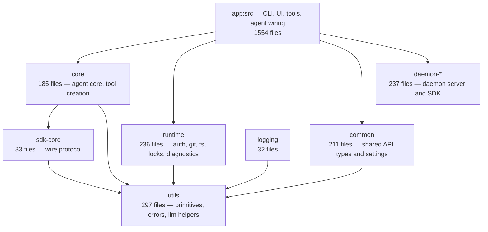

# Reference layer map (evidence-derived)

Source: `tools/archgraph/build.py` over the recovered tree
(`evidence/original/windows-x64`, untracked). Numbers below are reproduced by
re-running the tool; they describe the recorded windows-x64 build.

## Layers

## Package responsibilities (derived from directory contents)

| package                      | role                                                                                                                                  |
| ---------------------------- | ------------------------------------------------------------------------------------------------------------------------------------- |
| `app:src`                    | Process entry, command tree, hooks/components (terminal UI), tool implementations, MCP, sandbox, exec/streaming modes, ACP, telemetry |
| `core`                       | Agent loop internals, tool registry and `create-tool`, message/context handling                                                       |
| `runtime`                    | Auth (API key, customer-prem), git, file locking, JSON stores, frontmatter, diagnostics, computer/remote-control support              |
| `common`                     | Cross-cutting API schemas (backend routes, agent effectiveness, connectors) and settings shape                                        |
| `sdk-core`                   | Protocol definitions: `llm`, `tools`, `session`, `sessionV2`, `daemon`, `settings`, `mcp-oauth`, `models`, `host`                     |
| `daemon-core` / `daemon-sdk` | Background daemon (sessions, background tasks, transports) and its client SDK                                                         |
| `utils`                      | Errors (`errors/index.ts` is the graph's top hub, 187 importers), JSON, LLM helpers, settings, session helpers                        |
| `logging`                    | Structured logging, metrics enums, Sentry/tracing wiring                                                                              |
| `updater`                    | Self-update: version check, download, atomic replace                                                                                  |
| `environment`                | Platform/environment detection                                                                                                        |
| `builtin-skills`             | Skill markdown shipped inside the binary                                                                                              |

## Hot spots

- `packages/utils/src/errors/index.ts` — 187 internal importers; the error
  taxonomy is the de-facto cross-package contract.
- `packages/sdk-core/src/protocol/llm/index.ts` — 166 importers; defines
  the provider wire shapes the agent loop speaks.
- `packages/core/src/tools/enums.ts` (119) and
  `packages/core/src/tools/create-tool.ts` (55) — the tool registry's
  spine.
- `packages/utils/src/session/index.ts` (98) — session identity/records.

## Entry points

| entry                            | purpose                                                                               |
| -------------------------------- | ------------------------------------------------------------------------------------- |
| `src/index.ts`                   | Process entry shim: disk-fault and slow-path test hooks, then the CLI                 |
| `src/entrypoints/**` (131 files) | Interactive, exec, daemon, search, update, doctor, MCP/plugin/computer command groups |
| `src/commands/**` (108 files)    | Command implementations behind the `cac` registrations                                |
| `packages/daemon-core/**`        | Long-running server started by `droide daemon`                                        |

## Observed gaps

- 1,258 workspace import specifiers stay unresolved at file level: re-export
  barrels and type-only modules were elided by the bundler, so no source map
  covers them. Package-level edges are still recorded (`graph.json → package_edges`).
- 4 import cycles exist in the recovered graph (see `overview.md` in the
  generated evidence); they are not necessarily cycles in the source project,
  since elision changes the graph.
